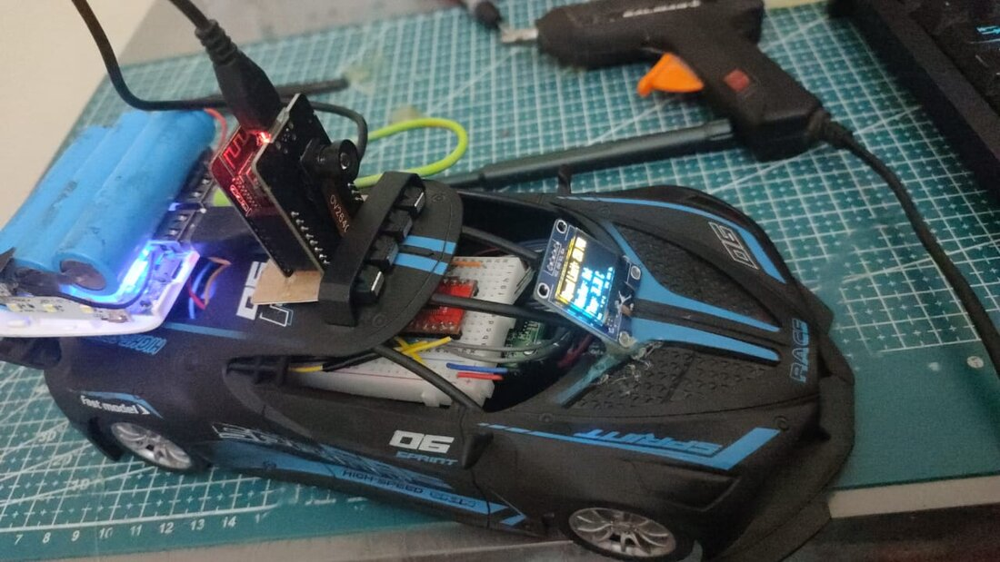
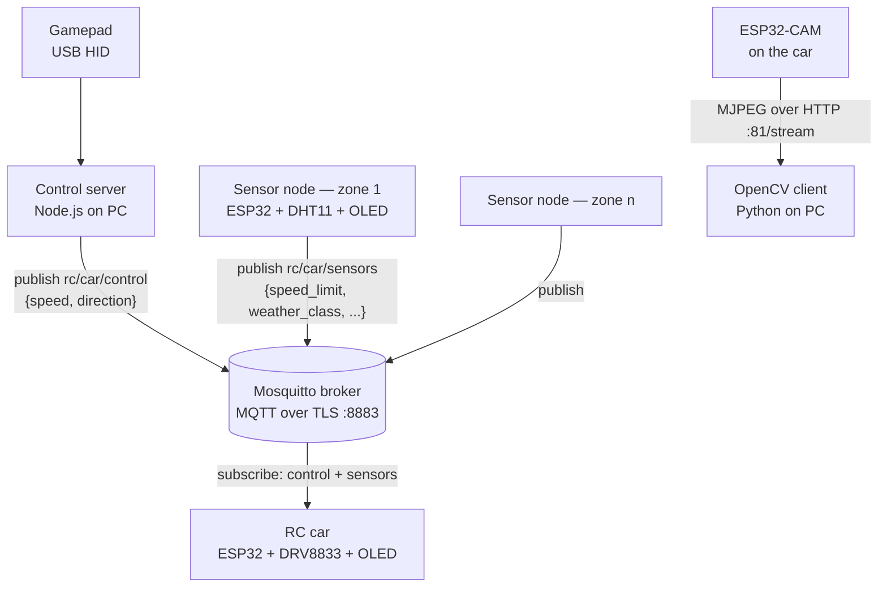
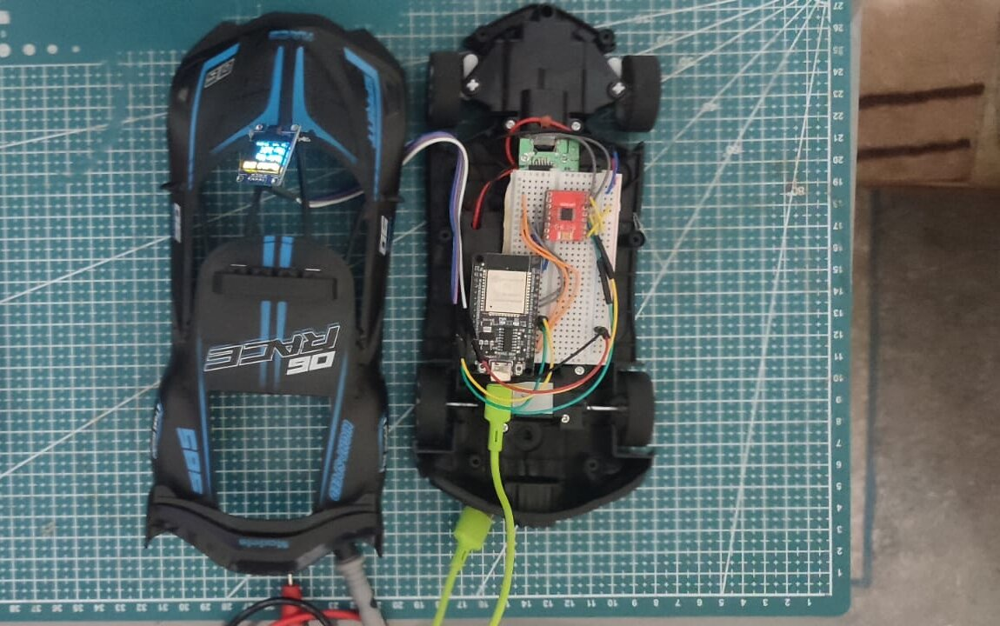
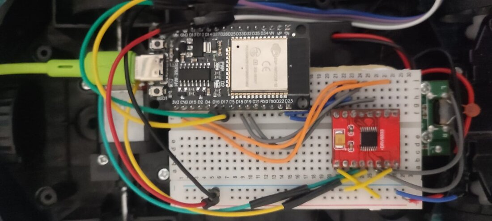
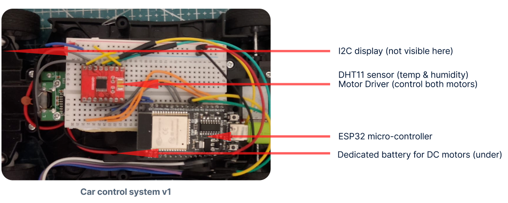
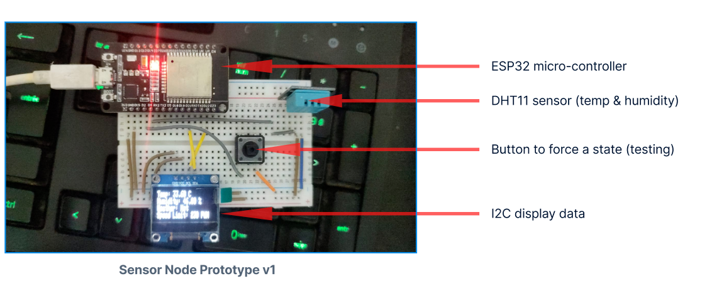
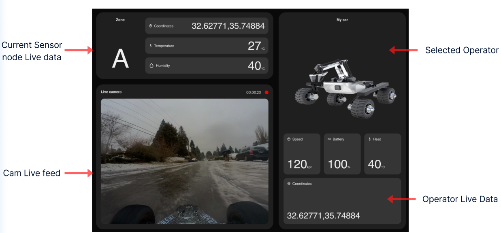

<div align="center">

# Smart IoT Operator — Wi-Fi RC Car

**A gamepad-driven RC car built on ESP32, with TLS-secured MQTT control, a live camera feed, and roadside sensor nodes that set the car's speed limit from the weather.**




[Full report (PDF)](final_report.pdf) · [Presentation (PDF)](Presentation_compressed.pdf)

</div>

---

## Overview

An off-the-shelf toy car, stripped and rebuilt around two ESP32 boards. A Node.js server on a PC reads a gamepad and publishes drive commands; the car subscribes to them over an encrypted MQTT channel and drives its motors through an H-bridge. Separate ESP32 sensor nodes measure temperature and humidity, classify the weather, and publish a speed limit that the car enforces on itself — the operator can push the stick all the way, but the car will not exceed what the zone allows.

Built as the IoT module project of a Master's in Embedded Systems & Digital Services (2023–2024).

## Highlights

- **Real-time control over Wi-Fi** — analog throttle and steering from a gamepad, read over raw USB HID and rate-limited to one command every 200 ms.
- **Secured messaging** — Mosquitto broker on port 8883 with TLS (CA certificate verification) and username/password authentication.
- **Environment-aware speed limiting** — sensor nodes classify conditions (Rainy, Hot, Cold, Humid, Dry, Normal) and the car clamps its PWM output to the published limit.
- **Live video** — ESP32-CAM (OV2640) streams MJPEG over HTTP; a Python/OpenCV client consumes the stream as the entry point for image processing.
- **On-device telemetry** — SSD1306 OLED displays on the car and the sensor node show speed limit, weather class, temperature and humidity.
- **Three transports, one control model** — the control link was built over UDP, then WebSocket, then MQTT, keeping the same speed/direction command format.

## Architecture



| Component | Hardware | Role |
|---|---|---|
| Control server | PC + gamepad | Reads stick positions, maps them to speed (−255…255) and direction (−1/0/1), publishes commands |
| Broker | Mosquitto | Routes messages, enforces TLS and authentication |
| Car control module | ESP32, DRV8833 motor driver, SSD1306 OLED | Subscribes to commands and sensor data, clamps speed, drives the motors with 5 kHz 8-bit PWM |
| Sensor node | ESP32, DHT11, SSD1306 OLED | Measures temperature and humidity, classifies weather, publishes a speed limit |
| Camera module | AI-Thinker ESP32-CAM | Streams video from the car |

### MQTT topics

| Topic | Publisher | Payload |
|---|---|---|
| `rc/car/control` | Control server | `{"speed": 180, "direction": -1}` |
| `rc/car/sensors` | Sensor node | `{"speed_limit": 190, "weather_class": "Rainy", "temperature": 21.5, "humidity": 64.0}` |

### Speed-limit rules

| Condition | Class | PWM limit (max 255) |
|---|---|---|
| Rain flag set | Rainy | 190 |
| Temperature < 10 °C | Cold | 180 |
| Humidity > 70 % | Humid | 200 |
| Humidity < 30 % | Dry | 220 |
| Temperature > 30 °C | Hot | 230 |
| Otherwise | Normal | 230 |

## Hardware

<table>
  <tr>
    <td width="50%"></td>
    <td width="50%"></td>
  </tr>
  <tr>
    <td align="center"><sub>Chassis with the body removed</sub></td>
    <td align="center"><sub>ESP32 and DRV8833 H-bridge</sub></td>
  </tr>
  <tr>
    <td></td>
    <td></td>
  </tr>
  <tr>
    <td align="center"><sub>Car control system v1</sub></td>
    <td align="center"><sub>Sensor node prototype v1</sub></td>
  </tr>
</table>

**Motor wiring (ESP32 → DRV8833)**

| Signal | GPIO | Function |
|---|---|---|
| AIN1 / AIN2 | 22 / 23 | Drive motor, forward / reverse |
| BIN1 / BIN2 | 18 / 19 | Steering motor, left / right |

The drive motors run from their own battery; a separate USB power bank feeds both ESP32 boards.

## Repository layout

```
├── server/
│   ├── serverMQTT.js          # Gamepad → MQTT over TLS (current)
│   ├── server_websocket.js    # Gamepad → WebSocket
│   └── server.js              # Gamepad → UDP, with D-pad camera-servo angle
├── car/
│   ├── websocket/             # ESP32 firmware: WebSocket motor control
│   └── CameraWebServer/       # ESP32-CAM firmware: MJPEG streaming server
├── CAR_UDP_CONTROL/           # ESP32 firmware: UDP motor control
├── Image-processing/main.py   # OpenCV client for the camera stream
├── final_report.pdf           # Design, implementation and demo
└── Presentation_compressed.pdf
```

The MQTT firmware for the car and the sensor node is documented in the [report](final_report.pdf) (chapter 2) and is not yet included in this repository.

## Getting started

**Requirements:** Node.js, Arduino IDE with the ESP32 board package (v3.x), Mosquitto, Python 3 with `opencv-python`, and a USB gamepad.

1. **Broker** — configure Mosquitto with a TLS listener on port 8883, a CA-signed server certificate, and a password file, then start it.
2. **Firmware** — set your Wi-Fi credentials in the sketch and flash it:
   - `car/CameraWebServer` to the ESP32-CAM (board: AI Thinker ESP32-CAM)
   - `CAR_UDP_CONTROL` or `car/websocket` to the car's ESP32
3. **Control server**
   ```bash
   cd server
   npm install
   node serverMQTT.js        # or server.js (UDP) / server_websocket.js
   ```
   Before running, edit the broker or ESP32 IP address at the top of the script, plus the CA certificate path and MQTT credentials for `serverMQTT.js`. The gamepad's USB vendor and product IDs are also set there.
4. **Video**
   ```bash
   python Image-processing/main.py   # set the ESP32-CAM stream URL first; press q to quit
   ```

## Roadmap



<sub>Design concept for the operator dashboard: live sensor-node data, camera feed and car telemetry.</sub>

- **SOS dispatch** — let any node raise a distress signal, and have the car locate and travel to it (the project's main goal)
- Operator dashboard, as in the concept above
- Obstacle detection and object tracking, using the PC as the vision-processing unit
- Autonomous navigation
- Historical data and logs for every component
- Migration from a local machine to cloud infrastructure
- Client certificates and per-topic authorization on the broker

## Author

**Mohamed Baarar** — [@eddev00](https://github.com/eddev00)
Supervised by Pr. Aimad Karkouch
